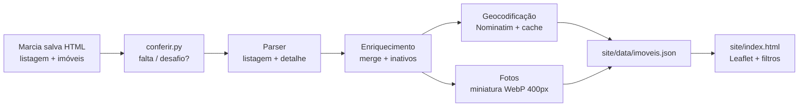

# PLAN.md — Leilões Londrina

Status: **Fase 1, aguardando aprovação.** Nenhum código de produção foi escrito.
Base da inspeção: 4 páginas de listagem (68 imóveis) e 16 páginas de imóvel salvas à mão em `tests/fixtures/manual/`.

## 1. Descoberta mais importante: a coleta é manual

O site está atrás de uma verificação anti-robô da Cloudflare (HTTP 403 na primeira requisição automática, observado).
Decisão: **o pipeline não acessa o site**. A Marcia abre e salva as páginas no próprio navegador
(`tests/fixtures/manual/tarefas.html` gera os links), e o pipeline processa os arquivos salvos.
Consequência: **a atualização diária automática (GitHub Actions) não funciona** enquanto o bloqueio existir.
Ela só passa a valer se o site liberar feed/API/autorização (mensagem de pedido a redigir).
Se aparecer bloqueio, a regra é parar e registrar; nada de contornar captcha ou trocar de IP.

## 2. Diagrama



```
 [Você salva HTML] -> [conferir.py] -> [Parser listagem+detalhe] -> [Merge / marca inativos]
                                                                       |            |
                                                          [Geocodifica: cache]  [Fotos -> WebP]
                                                                       \          /
                                                                   site/data/imoveis.json
                                                                              |
                                                              site/index.html (Leaflet + filtros)
```

## 3. Decisões vindas da inspeção

| Tema | Decisão | Evidência |
|---|---|---|
| Renderização | HTML estático, sem JS necessário. Parser com `selectolax`. | Preço, endereço, área e datas aparecem no texto do HTML salvo. |
| JSON embutido | Não existe (sem `ld+json`, sem `__NEXT_DATA__`). | grep sem resultado. |
| Paginação | Listagem tem `?pag=N` e 4 páginas hoje (19+19+19+11 = 68, bate com "68 imóveis encontrados"). | URLs salvas nos próprios arquivos. |
| Campos da listagem | preço, avaliação, desconto %, endereço, modalidade, data de encerramento, link. | Texto da listagem. |
| Campos só no detalhe | área, ocupado, tipo, bairro, banco/leiloeiro, 1ª/2ª praça, URL da foto. | Páginas de imóvel. |
| Coordenadas | **Não vêm no HTML**; geocodificar pelo endereço. O campo "Precisão da geolocalização" do site serve só como referência. | Nenhum lat/lng encontrado. |
| Cidade | Vem do endereço/URL (`/imovel/pr/londrina/`), **nunca da comarca** (um judicial de Londrina tem comarca Curitiba). | Imóvel 3058197. |
| Avaliação ausente | "Não informado" → `avaliacao = null`, `desconto_pct = null`. Não ler da descrição (formato `$713,000.00` ambíguo). | 9 de 16 imóveis salvos não têm avaliação. |
| Incremental | Detalhe só é lido de imóveis novos ou cujo preço/data mudou na listagem. | Listagem já traz preço e data. |

## 4. Estrutura

```
src/leiloes/sources/leilaoimovel.py   parse_listagem(html), parse_detalhe(html)
src/leiloes/geocode.py                cascata endereço -> rua+bairro -> bairro; cache JSON
src/leiloes/thumbnails.py             foto -> WebP ~400px
src/leiloes/pipeline.py               lê tests/fixtures/manual (ou data/entrada), gera site/data/imoveis.json
site/{index.html,app.js,style.css}    Leaflet + markercluster + filtros
scripts/{gerar_tarefas.py,conferir.py}  (já existem)
tests/test_parser.py                  testes nos HTMLs salvos
```

Observação: as fotos precisam de download (1 requisição por imagem, no CDN `image.leilaoimovel.com.br`).
Não sei ainda se o CDN também bloqueia. Se bloquear, o mapa mostra o imóvel sem foto e o limite é registrado.

## 5. Riscos

| Risco | Tratamento |
|---|---|
| Cloudflare bloqueia coleta | Coleta manual; pedir dados ao site. Sem contorno. |
| Layout do site muda | Parser por rótulos do texto ("Valor de Avaliação:"), testes nos fixtures; falha alta e clara se faltar campo obrigatório. |
| Endereço incompleto (judiciais) | Cascata de geocodificação; pin no centro do bairro quando preciso; sem coordenada vai para lista ao lado do mapa. |
| Nominatim limita uso | 1 req/s, User-Agent próprio, cache persistente. |
| Foto bloqueada | Mapa funciona sem foto. |
| Dados desatualizados | Mostrar "última atualização" na página; marcar como inativo o que sumiu. |
| Só 16 de 68 testados | Só valido o parser nos 16; as páginas restantes podem trazer variações. Terreno e outros tipos ainda não vistos. |

## 6. Previsão de tempo (trabalho do Claude Code, não calendário)

| Etapa | Tempo |
|---|---|
| Parser da listagem + detalhe, com testes | 30–40 min |
| Geocodificação com cache e cascata | 20–30 min (mais o tempo de rodar, ~1 s por endereço novo) |
| Fotos + miniaturas | 15–20 min |
| Pipeline, merge, inativos, JSON | 20–30 min |
| Mapa (Leaflet, filtros, popup, mobile) | 40–60 min |
| README + rodada completa com dados reais + resumo | 20–30 min |
| **Total** | **cerca de 2h30 a 3h30** |

Fora do total: salvar as páginas restantes (você) e a mensagem pedindo dados ao site.

## 7. Prova do plano nesta fase

Os 16 imóveis salvos serão a amostra. Resultado esperado na Fase 2: JSON com os 68 da listagem (os 16 com detalhe; os outros 52 só com os dados da listagem, marcados como "detalhe pendente"), e o mapa funcionando com eles.
